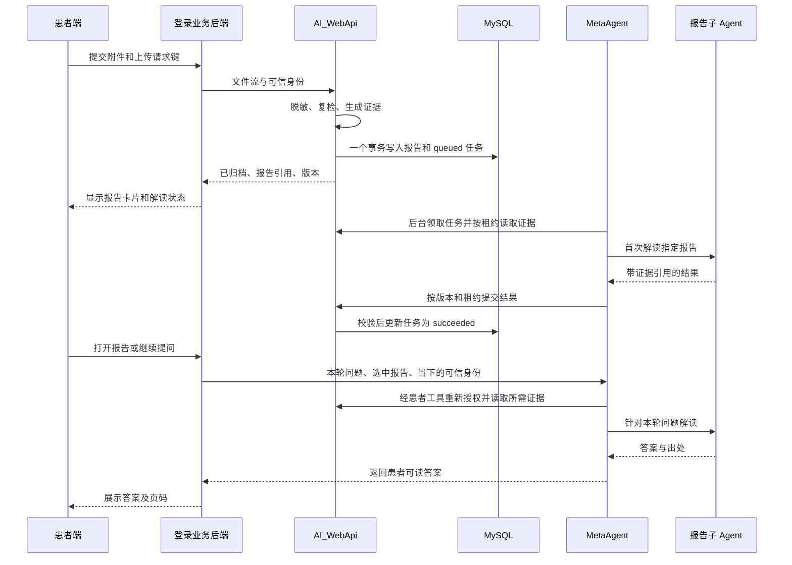

# 患者报告上传、脱敏归档与解读详细设计

**版本**　v0.1，2026-11-22，供接口与数据库设计评审。文中的新增表、端点和处理参数均为拟议契约。

患者在聊天窗口或报告列表提交文件。业务后端完成身份核验、脱敏、证据提取和 MySQL 归档。归档成功后，MetaAgent 自动调度报告子 Agent 生成一份基础解读。患者以后可以打开同一份报告，在新的会话里继续提问。

## 1. 服务分工与数据流

| 组件 | 职责 | 持有的数据 |
|---|---|---|
| 患者端及登录业务后端（BFF） | 文件上传、归档回执、报告选择、结果展示。从登录会话构造可信患者上下文 | 会话身份、上传请求键、当前选中的报告引用 |
| AI_WebApi 上传与归档服务 | 校验上传、执行脱敏、生成带页码的证据、写入两张业务表、授权访问 | 原件仅在受控临时区处理。持久化脱敏文件、证据、归属及解读 |
| AI_WebApi 患者工具 | 按本人和数据范围列报告、读证据、读首次解读 | 每次请求重新解析患者身份和范围 |
| MetaAgent 编排层 | 后台领取首次任务。交互时解析“这份”“上次”等指代并绑定报告。校验子 Agent 输出 | 后台任务租约仅驻留在执行进程。会话保存报告引用、版本和范围 |
| 报告子 Agent | 用指定报告的证据生成基础解读，或回答本轮具体问题 | 有界的脱敏证据、报告元信息、本轮问题 |



**报告来源。** 本文两张表负责患者提交的报告，包括历史上传件。对于系统内已有的 IReGo、IReTour、IReCog 和量表报告，MetaAgent 继续用对应家族的历史和分析工具读取授权范围内的结构化结果，保留其记录引用和 `source_snapshot`。患者明确问某份历史成品时，先核对成品对应的来源快照。只有当前源数据时，回答应标明是当前记录的解读。两类来源都符合且无法确定时，分别列出候选让患者选。图片制品的短期下载地址只用于展示。[患者工具家族](patient-tool-families.md) · [报告制品下载](../AI_WebApi/Controllers/PatientReportArtifactsV2Controller.cs)

## 2. 患者归属与访问范围

- 上传归属取自登录后端签发、AI_WebApi 重新验证的本人身份。数据库记录稳定的 `owner_user_id`，工具返回当前授权范围内的 `patient_ref`。上传表单仅接收文件。文件里的姓名、文件名及客户端传入的患者编号均不能决定归属。报告来源展示为“患者自行提交”，纸面身份未经独立核实。V1 仅开放本人入口，校验已验证凭证的主体角色，医生代查授权须另行定义。
- V1 允许两个上传入口。有当前机构时校验本人在该机构的有效关系并记录 `upload_business_id`。个人入口记为 NULL。查询 `all_tenants` 时只读本人的报告，查询 `current_tenant` 时另加 `upload_business_id = 当前机构`，个人入口上传件仅在本人全部范围内可见。产品文案叫“上传机构”。纸面上的出具机构可以作为报告内容，但不能决定租户可见性。
- 列表、分页、证据、解读、预览和重试使用同一条归属过滤。对已认证用户，外部引用不存在与无权查看返回相同的 `REPORT_NOT_AVAILABLE`。身份失效或机构范围无效按身份错误处理。面向模型的工具由程序注入 `system_context`、`data_scope`，服务凭证与患者凭证始终留在服务端。[患者范围过滤器](../AI_WebApi/Security/PatientV2ScopeFilter.cs) · [患者访问契约](patient-rehab-v2-contract.md)

## 3. MySQL 表结构

建议在 MySQL 8.0.16+ 的独立业务 schema 中使用 InnoDB。AI_WebApi 增加报告库专用连接，既有患者和康复源库继续由原连接读取。所有 `DATETIME(6)` 按 UTC 写入。纸面报告日期用 `DATE`。以下两段可在空 schema 中顺序执行。[MySQL CHECK 约束](https://dev.mysql.com/doc/refman/8.0/en/create-table-check-constraints.html)

### 3.1 `patient_report`　每行是一份归档版本

```sql
CREATE TABLE patient_report (
    id                    BIGINT UNSIGNED NOT NULL AUTO_INCREMENT,
    report_ref            CHAR(36) CHARACTER SET ascii COLLATE ascii_bin NOT NULL,
    revision              INT UNSIGNED NOT NULL DEFAULT 1,
    archive_state         ENUM('active','superseded','withdrawn') NOT NULL DEFAULT 'active',
    active_ref            CHAR(36) CHARACTER SET ascii COLLATE ascii_bin
                          GENERATED ALWAYS AS
                          (CASE WHEN archive_state = 'active' THEN report_ref ELSE NULL END) STORED,
    owner_user_id         BIGINT UNSIGNED NOT NULL,
    upload_business_id    BIGINT UNSIGNED NULL,
    upload_request_key    CHAR(36) CHARACTER SET ascii COLLATE ascii_bin NOT NULL,
    request_mac           BINARY(32) NOT NULL,
    mac_key_version       SMALLINT UNSIGNED NOT NULL,
    report_type           VARCHAR(32) NOT NULL DEFAULT 'unknown',
    report_date           DATE NULL,
    input_media_type      VARCHAR(64) CHARACTER SET ascii NOT NULL,
    archived_pdf          LONGBLOB NOT NULL,
    archived_bytes        INT UNSIGNED NOT NULL,
    archived_sha256       BINARY(32) NOT NULL,
    page_count            SMALLINT UNSIGNED NOT NULL,
    sanitizer_version     VARCHAR(48) NOT NULL,
    extractor_version     VARCHAR(48) NOT NULL,
    evidence_json         JSON NOT NULL,
    source_snapshot       BINARY(32) NOT NULL,
    archived_at           DATETIME(6) NOT NULL DEFAULT CURRENT_TIMESTAMP(6),
    PRIMARY KEY (id),
    UNIQUE KEY uq_report_revision (report_ref, revision),
    UNIQUE KEY uq_report_active (active_ref),
    UNIQUE KEY uq_owner_upload (owner_user_id, upload_request_key),
    KEY ix_owner_date (owner_user_id, archive_state, report_date, id),
    KEY ix_owner_tenant_date (owner_user_id, upload_business_id, archive_state, report_date, id),
    CONSTRAINT ck_report_size CHECK (archived_bytes BETWEEN 1 AND 20971520),
    CONSTRAINT ck_report_pages CHECK (page_count BETWEEN 1 AND 30),
    CONSTRAINT ck_report_revision CHECK (revision >= 1)
) ENGINE=InnoDB DEFAULT CHARSET=utf8mb4;
```

`report_ref` 是服务端随机 UUID。版本 1 对应首次上传。同一份报告经受控纠错或重新脱敏时，在一个事务里锁住当前版本、将其标为 `superseded`、写入相同归属和引用的新版本及其首次解读任务。患者主动上传另一个文件默认是另一份报告。撤回时将当前版本标为 `withdrawn` 并取消未结束任务。对外列表和内容读取只接受 `active` 版本。归档版本内的文件、元数据和证据不可原地修改。

`archived_sha256` 对脱敏 PDF 字节计算。每个证据块分配版本内稳定的 `block_id`，包含页码、原文摘录、可选表格行列/页面坐标、读取质量。结构化指标保留原文的值、单位、参考区间和异常标记。缺项用 null。纸面未标明或无法区分报告日期时，`report_date` 为 NULL。类型取服务端允许的类别，如 `lab`、`imaging_text`、`assessment`、`other` 或 `unknown`。

`source_snapshot` 是版本内容摘要。服务端对有版本号的规范化清单做 SHA-256，清单包含报告引用、版本、PDF 摘要、报告类型和日期、脱敏和提取器版本及证据 JSON 的规范化摘要。证据按页码与块顺序排列，清单使用固定字段、UTF-8 确定性序列化。接口用 64 位小写十六进制传输。权限范围另用 `scope_fingerprint` 核对。

### 3.2 `patient_report_interpretation`　首次任务兼作可靠队列

```sql
CREATE TABLE patient_report_interpretation (
    id                    BIGINT UNSIGNED NOT NULL AUTO_INCREMENT,
    job_ref               CHAR(36) CHARACTER SET ascii COLLATE ascii_bin NOT NULL,
    report_id             BIGINT UNSIGNED NOT NULL,
    source_snapshot       BINARY(32) NOT NULL,
    state                 ENUM('queued','running','succeeded','failed','cancelled') NOT NULL,
    attempt_count         SMALLINT UNSIGNED NOT NULL DEFAULT 0,
    available_at          DATETIME(6) NOT NULL DEFAULT CURRENT_TIMESTAMP(6),
    lease_epoch           BIGINT UNSIGNED NOT NULL DEFAULT 0,
    lease_digest          BINARY(32) NULL,
    lease_until           DATETIME(6) NULL,
    error_code            VARCHAR(64) NULL,
    retryable             BOOLEAN NOT NULL DEFAULT FALSE,
    result_json           JSON NULL,
    result_sha256         BINARY(32) NULL,
    receipt_digest        BINARY(32) NULL,
    interpreter_version   VARCHAR(64) NULL,
    created_at            DATETIME(6) NOT NULL DEFAULT CURRENT_TIMESTAMP(6),
    updated_at            DATETIME(6) NOT NULL DEFAULT CURRENT_TIMESTAMP(6)
                          ON UPDATE CURRENT_TIMESTAMP(6),
    finished_at           DATETIME(6) NULL,
    PRIMARY KEY (id),
    UNIQUE KEY uq_job_ref (job_ref),
    UNIQUE KEY uq_first_reading (report_id),
    KEY ix_claim (state, available_at, id),
    KEY ix_expired_lease (state, lease_until, id),
    CONSTRAINT fk_reading_report FOREIGN KEY (report_id) REFERENCES patient_report(id),
    CONSTRAINT ck_reading_lease CHECK (
        (state = 'running' AND lease_until IS NOT NULL AND lease_digest IS NOT NULL)
        OR (state <> 'running' AND lease_until IS NULL AND lease_digest IS NULL)),
    CONSTRAINT ck_reading_result CHECK (
        (state = 'succeeded' AND result_json IS NOT NULL AND result_sha256 IS NOT NULL
         AND interpreter_version IS NOT NULL AND receipt_digest IS NOT NULL)
        OR (state <> 'succeeded' AND result_json IS NULL AND result_sha256 IS NULL
            AND receipt_digest IS NULL)),
    CONSTRAINT ck_reading_finished CHECK (
        (state IN ('succeeded','failed','cancelled') AND finished_at IS NOT NULL)
        OR (state IN ('queued','running') AND finished_at IS NULL))
) ENGINE=InnoDB DEFAULT CHARSET=utf8mb4;
```

一份归档版本恰有一条首次任务，`report_id` 指向具体版本行。任务与版本行一同插入并复制同一 `source_snapshot`。模型更新不触发全库重跑。保存的 `interpreter_version` 指向包含模型、提示模板和结果 schema 版本的发布标识。追问写入当前会话的问答历史，不覆盖首次解读行。

列表查询只投影索引和摘要字段。文件预览经专用接口按主键读取 BLOB 并校验字节数和摘要。建议输入与归档各限 20 MiB，入库前另限证据 JSON（建议 1 MiB），并给数据库客户端和服务端的 `max_allowed_packet` 留足整条写入语句及协议开销。报告库、复制及备份均按患者数据限制访问并加密。业务上线前须确定归档、备份及会话的保留期。撤回后立即停止在线读取，物理清理按获批保留期执行。[MySQL 数据包大小](https://dev.mysql.com/doc/refman/8.0/en/packet-too-large.html)

## 4. 上传、脱敏与归档

### 4.1 面向患者端的业务 API

以下为 BFF 对患者端的拟议地址。BFF 用已登录会话鉴权并向 AI_WebApi 转发可信上下文。业务端点独立于患者工具 OpenAPI。上传控件直接流式发送附件，同一上传也适用于报告列表页。

| 方法与路径 | 请求 | 成功结果 |
|---|---|---|
| `POST /api/patient/reports` | `multipart/form-data`，单个 `file`。必填请求头 `Idempotency-Key`（客户端生成 UUID） | 首次归档返回 201，等价重放返回 200。字段见下例 |
| `GET /api/patient/reports` | 本人会话、日期或类型筛选、游标 | 与第 5 节列表工具共用授权查询，适用于会话外的“我的报告”页面 |
| `GET /api/patient/reports/{report_ref}?revision=1` | 本人会话、版本 | 返回类型、报告日期、归档时间、当前首次任务状态、可重试标识。成功时附带解读，可重试时返回当前轮次 `retry_epoch` |
| `GET /api/patient/reports/{report_ref}/content?revision=1` | 本人会话、版本 | 返回 `application/pdf` 及 `Cache-Control: private, no-store`，后台使用系统生成的文件名 |
| `POST /api/patient/reports/{report_ref}/retry-interpretation` | 本人会话，`revision`、`expected_source_snapshot`、`expected_retry_epoch` | 用轮次条件更新可重试的 `failed` 原行，重新排队并重置本轮尝试次数。重复点击或旧轮次重放均返回任务现态 |

```json
{
  "report_ref": "cb55ff7a-5242-4095-a44b-1b84938fa45f",
  "revision": 1,
  "source_snapshot": "1fa870ac3c236df7bbeed3910ebc29c44bb588deef15707c61bafafc1239c495",
  "archive_state": "active",
  "interpretation_state": "queued"
}
```

上传页面先显示“正在处理文件”。收到 201 后显示“已归档，等待解读”，可离开页面。报告卡按上述 GET 轮询（建议前台 2 秒起步，上限 15 秒退避，终态停止），重新打开时读库恢复。首次结果通过报告卡展示，不向可能已切换报告的对话自动插入答复。

### 4.2 文件处理顺序

1. **接收与校验。** 在读取正文前核验登录和上传范围，按流限制字节数。首版接受 PDF、JPEG、PNG 和 UTF-8 纯文本。粘贴内容可由控件按纯文本文件提交。检查实际文件格式、解码、页数、解码后像素预算和处理时限。首版建议最多 30 页，单张图上限 25 百万像素。加密 PDF、无法安全解析或超过限额时返回可操作的错误。页面或代理超时时支持同键重传。
2. **隔离临时输入。** 使用受限解析进程、本地 OCR、随机临时名和有容量上限的临时区。关闭网络取外部资源、请求体追踪和原文日志。原件、原始 OCR、中间页图只在该区处理。请求结束清理。进程异常退出由过期清扫补偿。
3. **脱敏并重建。** 将输入转换成固定分页的可视页，在页图像上结合 OCR、版面及规则定位姓名、证件号、联系方式、地址、病历号、签名、条码和二维码等标识。清除对应像素后，从干净页面重建 PDF。重建会舍弃原 PDF 的隐藏文字层、批注、附件、表单、脚本和输入图片元数据。保留有解读意义且可清晰定位的项目、日期、单位、参考区间和左右侧等原文限定词。
4. **独立复检与提取。** 重新打开待归档 PDF，对最终页再做 OCR、标识检测和结构检查。证据、日期和类型只从通过该流程的内容生成。疑似可识别区域无法定位、页面缺失或复检仍检出标识时，整份拒绝归档并提示重传。仅临床字段局部模糊而脱敏已通过时，允许归档，标记相应块为 `unreadable` 或 `uncertain`。确认身份泄露的风险与某个指标读不清分别处理。
5. **原子归档。** 短事务内插入版本行和 `queued` 任务，任一写入失败全部回滚。只在提交成功后返回引用。若已存在同一 `(owner_user_id, upload_request_key)`，重新鉴权并按请求指纹决定重放或冲突。并发唯一键竞争时回滚当前事务，再读取胜者。原件及其可识别元数据均不会写入两张表。

**请求指纹。** 流式计算带服务端密钥的 HMAC-SHA256，输入为版本化、带长度边界的“患者归属、上传机构或个人入口、检测到的输入类型、原始文件字节”。库里仅存 MAC 和密钥版本。同键重试用已存密钥版本核验。相同键和内容返回已归档版本的当前状态。同键不同内容或不同上传范围返回 409。重放遇到已撤回或被替代的旧版本时，仅返回不可用或版本变更状态。不同患者间无内容去重或命中提示。同一患者用新请求键提交视为新上传。

| 情况 | HTTP / 原因码 | 患者端行为 |
|---|---|---|
| 登录失效或范围不允许 | 401 / 403，现有身份原因码 | 恢复登录或切换有效入口 |
| 输入过大、格式不支持 | 413 `REPORT_LIMIT_EXCEEDED` / 415 `REPORT_TYPE_UNSUPPORTED` | 调整文件后重新提交 |
| 无法安全处理或脱敏复检失败 | 422 `REPORT_UNREADABLE` / `REPORT_REDACTION_UNVERIFIED` | 显示失败，提示提供清晰且可处理的文件，无报告卡或解读任务 |
| 已用请求键对应不同上传 | 409 `UPLOAD_KEY_CONFLICT` | 核对选择。有意上传另一份时生成新键 |
| 入库或处理依赖暂不可用 | 503 `REPORT_SERVICE_UNAVAILABLE` | 同键重试。提交结果不明时仍遵循已提交版本的重放语义 |

## 5. 报告子 Agent 与工具接口

### 5.1 在线工具

在现有 `POST /api/ai/patients/tools/{tool_name}` 下增加三个只读工具。使用服务 Bearer、可信 `system_context` 和 `data_scope`。模型只见业务参数。AI_WebApi 使用 `PatientV2ScopeFilter`，校验本人主体，并在授权查询后登记上传机构归属。统一返回 `ToolResponseDto` 的 `tool_name`、`contract_version="2.0.0"`、`request_id`、`status`、`data`、`reason_codes`、`meta`、`query_scope`。成功数据包含同范围 `patient_ref`。[响应封套](../AI_WebApi.Model/DTOs/AITools/ToolResponseDto.cs) · [患者工具目录](../AI_WebApi.Model/AITools/PatientToolFamilies.cs)

| 工具 | 业务输入 | 返回的 data |
|---|---|---|
| `list_patient_uploaded_reports` | 可选 `report_type`、`date_from`、`date_to`（含两端）、`date_field=report_date\|archived_at`、`cursor`、`page_size`（默认 10，上限 20） | `records[]` 含 `report_ref, revision, source_snapshot, report_type, report_date, archived_at, record_tenant, interpretation_state`。另有 `next_cursor`。返回摘要，不加载 PDF、证据和解读正文 |
| `get_patient_report_evidence` | 必填 `report_ref, revision, expected_source_snapshot`。可选 `page_from, page_to`（从 1 起）、`cursor` | 对应版本的 `blocks[]`、页数、快照、覆盖范围、读取限制和 `next_cursor`。每次建议至多 5 页、50 个块，单页过长时按块续读 |
| `get_patient_report_interpretation` | 必填 `report_ref, revision, expected_source_snapshot` | `interpretation_state, retryable, finished_at`。仅成功时返回 `result`、`interpreter_version` 和所用快照。解读尚在排队仍返回可读状态 |

列表默认按纸面报告日期降序，日期缺失排在最后，同日以内部主键降序稳定翻页。时间筛选使用明确日期字段。缺失报告日期的记录不匹配报告日期区间。按上传日筛选时按产品时区（首版拟用 Asia/Shanghai）的自然日转 UTC 半开区间。游标由服务端签名，绑定患者、范围摘要、筛选条件和排序位置，超时或切换范围后重新查询。证据游标另外绑定报告版本、页范围和快照。

工具业务不可用沿用 HTTP 200 加 `status=unavailable`。无匹配列表返回成功及空数组。指定报告不可见返回 `REPORT_NOT_AVAILABLE`。已通过归属校验但版本或快照过期返回 `REPORT_SOURCE_CHANGED`，编排层重新定位。身份错误返回 401/403，依赖失败返回 503。部分可读用 `partial` 并列出具体页或项目。翻页未完与原件字段缺失分别表示。

以下是同一份报告的证据请求与返回片段，样例指标为虚构数据。`quality=verified` 表示该字段通过归档提取的一致性校验。

```json
{
  "report_ref": "cb55ff7a-5242-4095-a44b-1b84938fa45f",
  "revision": 1,
  "expected_source_snapshot": "1fa870ac3c236df7bbeed3910ebc29c44bb588deef15707c61bafafc1239c495",
  "page_from": 2,
  "page_to": 2
}
```

```json
{
  "page_count": 3,
  "blocks": [{
    "block_id": "p2-r04",
    "page": 2,
    "kind": "measurement",
    "label": "示例项目 A",
    "value_text": "12.1",
    "unit_text": "U/L",
    "reference_text": "4.0–10.0",
    "flag_text": "↑",
    "quality": "verified",
    "excerpt": "示例项目 A　12.1 U/L　4.0–10.0　↑"
  }],
  "coverage": {"page_from": 2, "page_to": 2, "complete_for_requested_pages": true},
  "next_cursor": null
}
```

### 5.2 子 Agent 调用契约

| 模式 | MetaAgent 绑定的输入 | 子 Agent 应交付的结果 |
|---|---|---|
| `initial` | 任务指定的报告引用、版本、快照、按页读取的证据与覆盖信息 | `summary`、`findings[]`、`limitations[]`、已读页范围。每条针对本报告的陈述带 `evidence_refs[]` |
| `follow_up` | 本轮问题、已选报告版本、当轮授权读取的证据，可附同快照的首次解读 | 面向问题的 `answer`、含页码和块 ID 的引用、缺失或无法判断的内容。直接返回本轮，不回写首次任务 |

每个事实单元采用 `{text, evidence_refs:[{page, block_id}]}`。首次解读的 `summary` 和 `findings` 均由这种单元组成。单独的 `limitations` 用于报告缺项、不可读页或未完整覆盖。本轮回答按相同单元引用后再合成为可读正文。编排器把报告文字当作待解释的数据。工具授权、报告选择和归档写入均由程序控制。结果校验按同一快照解析每个引用，对数值、单位、范围和原文标记逐项比对。引用不存在或数值不符时重新生成一次，仍失败则返回错误。异常表述应区别“报告标高”和“根据区间推算”。证据缺失时直接说明。基础解读仅解释报告内容，治疗或用药决定交由临床人员。

例如，一份三页报告中只有第 2 页这一行出现上箭头，首次结果可采用以下形状。患者端根据提交时已经绑定的报告引用、版本和页码打开对应页。

```json
{
  "summary": [
    {"text": "报告在示例项目 A 旁标出上箭头。", "evidence_refs": [{"page": 2, "block_id": "p2-r04"}]}
  ],
  "findings": [
    {"text": "示例项目 A 为 12.1 U/L，报告列出的参考区间为 4.0–10.0 U/L。", "evidence_refs": [{"page": 2, "block_id": "p2-r04"}]}
  ],
  "limitations": [],
  "pages_read": [1, 2, 3]
}
```

## 6. MetaAgent 如何触发首次解读

**触发条件是归档事务提交。** 报告服务将 `queued` 行作为待办事件。MetaAgent 的后台 worker 通过私有 HTTP 接口领取，不需要患者保持在线，也无需再次发送聊天消息。MySQL 是任务和结果的唯一事实来源。后台执行身份只允许领取和处理指派的单份报告，患者的短期登录凭证不会进入队列。

| AI_WebApi 私有端点（均为 POST） | 请求 | 返回或效果 |
|---|---|---|
| `/internal/report-jobs/claim` | 专用服务认证，每次领取一条 | 无任务返回 204。成功返回 `job_ref, report_ref, revision, source_snapshot, lease_epoch, lease_token, lease_until, page_count` |
| `/internal/report-jobs/{job_ref}/evidence` | 当前租约、预期快照。分页参数同在线证据工具 | 仅返回所绑定报告的脱敏证据。复用同一证据读取实现 |
| `/internal/report-jobs/{job_ref}/renew` | 当前租约、预期快照 | 有效且仍获授权时延长租约，返回新到期时间 |
| `/internal/report-jobs/{job_ref}/complete` | 当前租约、预期快照、`result`、`interpreter_version` | 复验归属、版本、证据及结果 schema，原子落库后返回 200 |
| `/internal/report-jobs/{job_ref}/fail` | 当前租约、预期快照、受控 `error_code` | 服务端按错误类别和剩余次数决定延时重排或失败，返回任务状态 |

以上端点仅注册到内部服务入口，以独立服务身份鉴权。除 claim 外均由程序附上 `lease_epoch` 及保密请求头 `X-Report-Job-Lease`。AI_WebApi 只保存随机租约令牌的摘要。每次读证据、续租和写结果均核对任务、当前版本、快照、租约和到期时间，并按档案记录的本人账号及原上传范围复核当前有效性。账号或所需机构权限已失效时取消任务，临时查权失败时停止读写并重试。服务身份本身不具备患者列表或其他报告的读取权限。

1. **领取。** 短事务中从到期 `queued` 行按 `available_at, id` 取一条，使用 `FOR UPDATE SKIP LOCKED`，改为 `running`，递增 `attempt_count` 和 `lease_epoch`，写入租约摘要和期限后提交。建议初始租约 90 秒、每 30 秒续租，空闲时退避轮询。数据库事务在模型运行期间已结束。[MySQL 锁定读](https://dev.mysql.com/doc/refman/8.0/en/innodb-locking-reads.html)
2. **调度与取证。** MetaAgent 将已领取的任务确定性地路由给报告子 Agent，使用独立后台运行上下文。执行器按页读取、按块分批，记录已覆盖页和无法辨认的内容。大报告可以按页生成带引用的中间事实、再合并。只读了一部分时明确标出范围。基础解读不读取患者的其他聊天内容或报告。
3. **提交。** 在事务内锁住报告与任务，检查版本仍有效，以当前 `running + lease_epoch + lease_digest + 未过期` 做条件更新。成功后保存规范化结果的 SHA-256、解释版本、完成时间与 `receipt_digest`，清除租约。回执摘要是对“认证服务标识、任务、轮次、租约令牌摘要、快照、结果摘要、解释版本”做确定性编码后的 SHA-256。若提交成功但应答丢失，仅在当前仍可见且重放请求算出的回执摘要完全相同时返回 200 已提交，响应不含正文。其他轮次或不同结果返回 409。涉及两行的写操作统一采用先报告、后任务的加锁顺序。
4. **恢复。** 过期扫描器按 `ix_expired_lease` 锁定过期行，并校验状态及轮次。暂时性失败或 worker 退出后，清除租约并重排，建议最多三次总尝试，重试间隔 30 秒、2 分钟。次数用尽时标为 `failed` 并保留可否手动重试。拒绝访问、撤回或版本替换转 `cancelled`。无法形成有依据的解读转 `failed` 并给出原因。手动重试沿用原任务，`lease_epoch` 始终单调递增。整个流程允许重复计算，但一个归档版本只会接受一个首次结果。

worker 遇到 409 `REPORT_LEASE_LOST` 或 `REPORT_JOB_INACTIVE` 即停止本轮并丢弃未提交结果。授权依赖超时或模型限流可退避重试。结果引用无效返回 422 `REPORT_EVIDENCE_INVALID`，在本轮纠错预算用尽后以同一错误码调用 fail。每次执行另设总时限（建议 10 分钟），到期主动结束本轮，避免失去进展的任务一直续租。

| 任务状态 | 患者端显示 | 允许的下一步 |
|---|---|---|
| `queued` / `running` | 已归档，等待解读 / 正在解读 | 轮询本卡。具体问题仍可读取已归档证据 |
| `succeeded` | 基础解读与出处 | 展示或继续追问 |
| `failed` | 报告已保存，解读暂未完成 | 按原因重新尝试或提示提交更清晰的文件 |
| `cancelled` | 原任务已结束 | 仅在当前仍可见时展示允许操作。旧版本、撤回件和已失权内容均停止读取 |

## 7. MetaAgent 如何处理选报告和追问

1. **先绑定本轮身份。** 复用现有 `TrustedScope` 与患者工具网关。显式点击的报告卡优先，其次是用户本轮明确指定的来源、报告日期或类型，最后才使用同一会话已有的报告锚点。新输入与旧锚点冲突时按新输入查询。查找“上个月的检查”用报告日期，“昨天上传的”用归档时间。
2. **解析候选。** 唯一匹配时选中，多份匹配时返回类型、日期、上传时间等最少区分信息并等候选择，零匹配时说明范围和筛选条件。“最近一次”允许排序选择，报告日期相同而患者未指定上传先后时请其确认。候选页、序号和选择令牌绑定当前范围。首次任务后台完成不能改变会话当前选中的报告。
3. **固定版本再答。** 程序绑定 `source_kind, report_ref, revision, source_snapshot`，调用在线工具。问“整体怎么看”优先读取已完成的首次解读及其引用。问“哪几项标高”或具体指标时，读取归档证据，按所问范围遍历分页。基础解读仍处理中也可以答具体问题，不再创建首次任务。仅在归属校验通过且同一 `report_ref` 有可见的新版本时，`REPORT_SOURCE_CHANGED` 响应附当前版本与快照。编排器丢弃旧证据，用新快照重新取证，并向患者标明使用了更新件。失权或撤回时清除锚点并停止展示旧答案作为新结论。
4. **保存会话锚点。** 按 `thread_id`、本人绑定和 `scope_fingerprint` 隔离选中项。会话只持久化必要的引用和患者实际看到的消息。证据全文、文件、任务租约、短期链接及身份令牌不写入长期记忆或通用知识库。账户、范围或会话改变时重新定位。不同设备或并发轮次用会话版本/请求序号更新锚点，较早返回的回答不能覆盖较新的选择。

**一次追问示例。** 患者点选 11 月 20 日的报告，询问“哪项标了向上箭头？”。MetaAgent 用卡片的引用与快照读取所有相关页。若仅有上例中的一条，回答可为“第 2 页的示例项目 A 标了 ↑，结果为 12.1 U/L，这份报告列出的参考区间是 4.0–10.0 U/L。”下一轮问“参考范围是多少？”时继续引用同页同一行。如果患者改问“十月那份呢？”，重新按十月筛选。系统生成的记录同样保存来源家族与原生记录引用，由对应工具重新授权和读取。

## 8. 实施落点与验收

| 位置 | 需要落地的改动 |
|---|---|
| AI_WebApi | 新增报告库连接、两表迁移、归档仓储和脱敏服务。分别实现业务 API、在线患者工具和私有任务控制器。将在线工具纳入 v2 过滤器与 OpenAPI，目录注册 `uploaded_report` 的列表、证据和解读三项能力。后台端点使用独立授权策略。[路由约定](../AI_WebApi/Security/PatientV2RoutingConvention.cs) · [工具家族定义](../AI_WebApi.Model/AITools/PatientToolFamilies.cs) |
| MetaAgent | 以本机 `metaAgent` 提交 `e1c8819` 为对接参考。在 `medical_tools/registry.py` 登记三个在线工具并沿用 `medical_tools/adapters/ai_webapi.py` 的身份注入和封套验证。在患者会话路由与 `ConversationState` 增加可空的上传报告锚点，兼容已有会话。在 `ApplicationService.start` 的请求指纹加入报告来源、引用、版本和快照，避免同一请求号在不同报告卡间复用旧回答。后台 worker 以受限客户端访问私有端点，与会话路由共用报告子 Agent 和结果校验器 |
| 登录后端及患者端 | 新增附件直传、请求键与状态卡，处理页面刷新和重传。向聊天服务传选中报告的引用与版本，用户不需要复制编号 |

| 验收场景 | 通过条件 |
|---|---|
| 含隐藏文字层、二维码、图片元数据或批注的合成样本 | 归档 PDF、提取证据、模型输入、日志均无样本中的标识。数字、单位和行列对应仍可定位。复检不确定的文件零归档、零任务 |
| 写完报告后模拟任务写入失败。并发提交同一请求键 | 前者两表均无残留。后者仅一个报告版本和一条任务，响应丢失后可同键找回。相同键换文件返回 409 |
| 原始身份凭证过期、患者离线。后台并发或进程中断 | 原上传授权仍有效时能完成首次解读。撤回/失权时停止。旧租约的晚到结果无法覆盖新结果，重复提交终态结果幂等 |
| A/B 两名患者、同一患者的两家机构、个人入口、医生代查 | 列表、读取、预览、重试均遵守第 2 节范围。私有领取凭证不能列患者报告。另一任务的租约不能取证 |
| 同名或同日报告、未知报告日期、范围切换、归档版本替换 | 正确澄清候选。筛选和翻页稳定。旧锚点失效。并发上传两份报告时，各卡显示各自结果 |
| 模糊字段、超出单页块数、基础解读未完成时追问 | 明示证据缺失，继续翻页后再声称已查全。追问能引到正确页和版本，首次任务数量不增加 |
| 旧系统报告与上传件同时命中 | 明确来源供选择。系统报告使用对应分析工具及快照，过期图片地址不会成为数据来源 |

上线前用合成报告完成端到端联调，再用经授权的代表性样本评估脱敏漏检、字段保真和误拒率。分别记录脱敏失败、归档事务失败、最老排队时长、重试耗尽和证据校验失败。日志用请求或任务引用关联，错误信息采用原因码。首版大小、页数、超时和轮询间隔均为待压测的默认值。若调整归档大小或页数，应用限制与表约束须同步变更。

**本版验证记录。** 在隔离的 MySQL 8.0.45 中执行了本文两段 DDL。用合成记录验证了事务回滚、上传请求键与首次任务唯一约束、外键、单一活动版本、状态约束、领取查询，以及租约轮次匹配和失配时的条件写入。接口与 Agent 流程属于待实施设计，脱敏质量和端到端行为留待实现后按上表验收。
